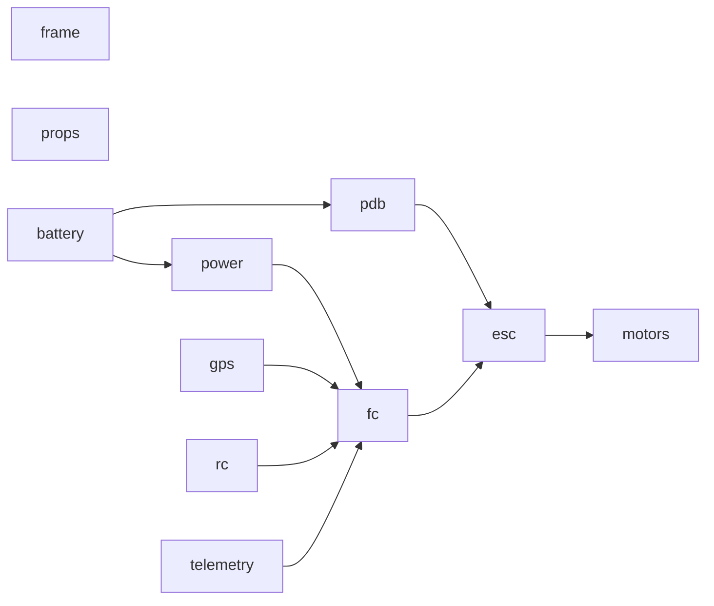

# X500 V2 + Pixhawk 6C assembly dossier

**Status: BLOCKED — documentation-based assembly preparation only.**

PX4 assembly source SHA256: `f6759d026ea9dfec459e1b0ff63f370915d4bd6f813e57602977602d06d48b36`

## Component inventory

| Component | Quantity | Reference part | Procurement verification |
| --- | ---: | --- | --- |
| frame | 1 | X500 V2 frame kit SKU30120 | not confirmed |
| fc | 1 | Pixhawk 6C flight controller | not confirmed |
| power | 1 | Power module PM02 V3 or kit-specified compatible revision | not confirmed |
| motors | 4 | Holybro 2216 KV920 motors | not confirmed |
| esc | 4 | BLHeli S 20 A ESC rated for 4S | not confirmed |
| props | 6 | 1045 propellers with correct rotational handedness and retainers | not confirmed |
| pdb | 1 | X500 V2 power distribution board with battery and ESC connectors | not confirmed |
| gps | 1 | Kit-specified M10 GPS | not confirmed |
| telemetry | 1 | SiK telemetry radio matched to regional frequency | not confirmed |
| battery | 1 | 4S 3000–5000 mAh 20C+ LiPo with confirmed XT60 interface | not confirmed |
| rc | 1 | Compatible RC transmitter and receiver for planned flight mode | not confirmed |

## Source-backed assembly sections

### Payload and Battery Holder
Source: https://docs.px4.io/main/en/frames_multicopter/holybro_x500v2_pixhawk6c
- Source lists 5 discrete assembly or configuration items; review the linked authoritative guide for exact sequence, illustrations and fasteners.

### Power Module
Source: https://docs.px4.io/main/en/frames_multicopter/holybro_x500v2_pixhawk6c
- Source lists 3 discrete assembly or configuration items; review the linked authoritative guide for exact sequence, illustrations and fasteners.

### Landing Gear
Source: https://docs.px4.io/main/en/frames_multicopter/holybro_x500v2_pixhawk6c
- Source lists 2 discrete assembly or configuration items; review the linked authoritative guide for exact sequence, illustrations and fasteners.

### Power
Source: https://docs.px4.io/main/en/frames_multicopter/holybro_x500v2_pixhawk6c
- Source lists 0 discrete assembly or configuration items; review the linked authoritative guide for exact sequence, illustrations and fasteners.

### Arms
Source: https://docs.px4.io/main/en/frames_multicopter/holybro_x500v2_pixhawk6c
- Source lists 5 discrete assembly or configuration items; review the linked authoritative guide for exact sequence, illustrations and fasteners.

### Propellers
Source: https://docs.px4.io/main/en/frames_multicopter/holybro_x500v2_pixhawk6c
- Source lists 4 discrete assembly or configuration items; review the linked authoritative guide for exact sequence, illustrations and fasteners.

### GPS
Source: https://docs.px4.io/main/en/frames_multicopter/holybro_x500v2_pixhawk6c
- Source lists 2 discrete assembly or configuration items; review the linked authoritative guide for exact sequence, illustrations and fasteners.

### Pixhawk 6C
Source: https://docs.px4.io/main/en/frames_multicopter/holybro_x500v2_pixhawk6c
- Source lists 3 discrete assembly or configuration items; review the linked authoritative guide for exact sequence, illustrations and fasteners.

### Install/Configure PX4
Source: https://docs.px4.io/main/en/frames_multicopter/holybro_x500v2_pixhawk6c
- Source lists 12 discrete assembly or configuration items; review the linked authoritative guide for exact sequence, illustrations and fasteners.

### Tuning
Source: https://docs.px4.io/main/en/frames_multicopter/holybro_x500v2_pixhawk6c
- Source lists 0 discrete assembly or configuration items; review the linked authoritative guide for exact sequence, illustrations and fasteners.

## Interface verification checklist

- **battery → power** (battery to selected power module / regulated-controller supply): physical battery plug, power-module input rating, polarity and battery branch — reference_only
- **battery → pdb** (main propulsion energy distribution): exact battery/PDB connector mating and polarity; compare kit wire harness — reference_only
- **power → fc** (regulated flight controller POWER connection): exact PM02 module output voltage/pin map and Pixhawk POWER connector; never direct battery — reference_only
- **pdb → esc** (four ESC high-current supplies): each ESC supply voltage/current rating and connectors — reference_only
- **esc → motors** (four independent brushless propulsion channels): motor phase terminals, connector types and manufacturer pairing — reference_only
- **fc → esc** (four PX4 actuator command lines): output pin assignment and ground reference against selected Pixhawk revision — reference_only
- **gps → fc** (GPS and compass link): board/port/cable voltage and pinout — reference_only
- **rc → fc** (operator control link): transmitter-receiver protocol, port and regional compliance — unresolved
- **telemetry → fc** (ground-station radio telemetry): radio variant and allowed local frequency — unresolved

## Conceptual interface graph (NOT pin-level wiring)

## Go/no-go checks

- **kit_identity** [hold]: Exact manufacturer kit SKU and hardware revisions not observed
- **source_verification** [reference_captured]: PX4 assembly HTML captured with SHA256; manufacturer BOM pages not frozen
- **connector_mating** [hold]: ESC/motor and battery/PDB connectors not matched to actual inventory
- **controller_regulator** [hold]: Power module output voltage, connector pinout and regulator ratings unverified
- **propulsion_performance** [hold]: Exact thrust/current, AUW, battery discharge and runtime margins remain uncalculated
- **physical_fit** [hold]: Frame dimensions and actual component mounting not independently measured
- **software** [hold]: PX4 SITL, firmware, parameters and output map not exercised in this run
- **physical_release** [hold]: No powered testing, physical assembly or flight authorization

No parts purchased, physical wiring performed, or flight claimed.
