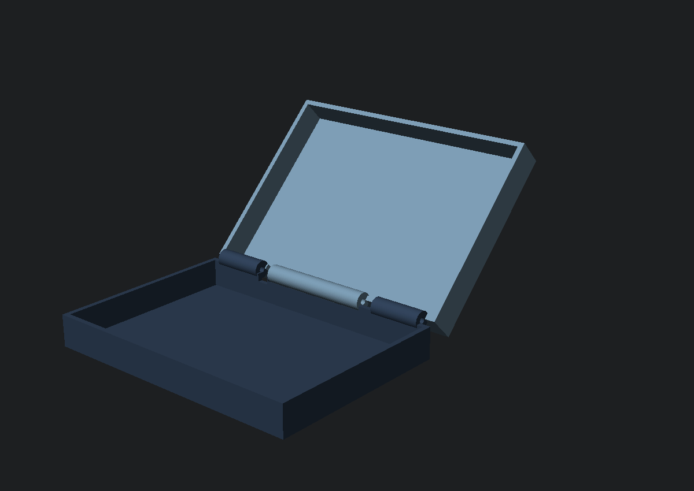

# HS Pocket SSH Clamshell S1 — 4.3-inch folding ESP32 terminal

**Next HS experiment:** [S2 two 4.3-inch touchscreens + onboard RS485 ordinary-hinge bridge](dual_touch/README.md). This is an additional, independent design alternative, **not** a claim of assembled or working dual-screen hardware. The original CardKB keyboard design remains intact.

**Actual status:** 2026-11-06. This is a **real, reproducible Hardware Splicer CAD + electrical-interface casefile**, **not** a fabricated or SSH-connected physical device. Parts have not been ordered, connected, flashed or physically tested. The target is a low-cost, calculator-sized **clamshell** whose purpose is to SSH into an existing Optiplex, rather than a foldable phone or full laptop.



## Design / dimensions

- **Folded design envelope:** 120 × 85 × **29.6 mm** (nominal shells and gap, **not** including rear hinge projection ~5.2 mm, feet, buttons, ports or manufacturing variation).
- **Screen/lid:** [Waveshare ESP32-S3-Touch-LCD-4.3](https://docs.waveshare.com/ESP32-S3-Touch-LCD-4.3): 4.3-inch 800 × 480 landscape RGB display with ESP32-S3 onboard, nominal touch board planform 106.1 × 67.8 mm. This is **not** the 4.3B or 4.3C variant. 16 MB flash, 8 MB PSRAM, Wi-Fi. The board has a CS8501 single-cell charging circuit; **do not add another battery charger by default**.
- **Base/keyboard:** [M5Stack CardKB v1.1 U035-B](https://docs.m5stack.switch-science.com/en/unit/Unit_CardKB_v1.1): 88 × 54 × 5 mm 50-key compact QWERTY I²C keyboard, address **0x5F**, supply **5 V**.
- **Folding mechanism:** Two PETG FDM trays with interleaved **three-knuckle, 2 mm steel pin** hinge. 7 mm axial gaps between knuckles reserve a **5.2 × 3.6 mm** harness entry. The cable's actual path, bending under repeated folding and pin retention still require physical testing.
- **First bring-up:** 5 V USB-C external supply. Later optional protected 3.7 V lithium battery only after verifying battery polarity, charger, cell fit, thermal behavior and protection; pack excluded from initial BOM.

These are **planform-based dimensions only**. PCB height, screw-hole coordinates, connectors, USB access, keycap closure clearance and the *actual* 4.3-inch module stack are **not** verified. The trays are still empty pockets without calibrated PCB mounting posts/retainers or exterior connector access. This is a deliberately honest starting mechanical proof, not a consumer-ready enclosure.

## Complete proposed BOM and budget (NT$)

| Item | Source / assumption | Budget |
|---|---|---:|
| Waveshare ESP32-S3-Touch-LCD-4.3 | [ICShop observed ask](https://www.icshop.com.tw/en/products/368031700131), **sold out at snapshot** | 1,250 |
| M5Stack CardKB v1.1 | [ICShop observed ask](https://www.icshop.com.tw/zh-hant/products/388350300011), **sold out at snapshot**; [DigiKey](https://www.digikey.tw/zh/products/detail/m5stack-technology-co-ltd/U035-B/16679766) alternate ask NT$288, shipping extra | 339 |
| Two-channel bidirectional I²C level shifter | **Unquoted estimate**; verify correct module and pull-up | 55 |
| 4-wire flexible harness/connectors | **Unquoted estimate** | 95 |
| 2 mm steel hinge pin and retention | **Unquoted estimate** | 45 |
| Two PETG shell prints | **Unquoted estimate**, actual slicer mass unknown | 110 |
| USB-C power/cable | **Unquoted estimate** | 100 |
| **Provisional parts total** | No battery; excludes shipping, taxes, tools, labor, fit corrections | **1,994** |

Do not order from the budget alone: neither key Taiwanese supplier line was confirmed in stock, nor is an actual delivered BOM quote available. Some components may already be owned or salvaged.

## Existing HS engineering tools genuinely used

This runs through the **existing Mecha-Splicer** `generate_bundle()`: parses `clamshell_ssh_terminal.json`, executes native DFM, generates an integrated BOM, and generates real OpenSCAD for both shells and the posed assembly. OpenSCAD **2021.01 CGAL** exported real binary STLs. A separate mesh audit verified *each shell* has zero non-manifold edges. The built-in **six-position CGAL boolean intersection check** across **0, −30, −60, −90, −135 and −165 degrees** returned *empty intersection in all tested positions*. This proves sampled **shell/shell interference clearance only**, **not** continuous hinge motion, bearing force, fatigue, cable bending or keyboard/display fit.

The same command calls existing **HS `plan_level_shift_circuit()`**, for a generic `esp32-devkit` logic proxy and four-channel shifter registry entry representing a two-wire I²C translation path. It yields `ready_for_review` with **two open critical gates** (LV/HV/GND voltage measurements and SDA/SCL continuity/idle levels). **Neither the exact Waveshare PCB nor CardKB is fully modeled in the HS electronic component registry**. No KiCad schematic/PCB/DRC is claimed or generated.

### Reproduce on an OpenSCAD-enabled workstation

```bash
PYTHONPATH=apps/mecha-splicer/src python3 examples/cyberdeck/produce_terminal.py \
  --openscad /usr/bin/openscad

PYTHONPATH=apps/mecha-splicer/src:apps/mecha-splicer:src \
  python3 -m pytest -q examples/cyberdeck/tests/test_clamshell.py \
  apps/mecha-splicer/tests/test_bundle.py tests/test_circuit_synthesis_planners.py
```

On the authorized Optiplex the actual OpenSCAD AppImage was used at `/home/phyrexian/chatgpt-work/hs-native-product-20261104/tools/OpenSCAD-2021.01-x86_64.AppImage`. It needs `--appimage-extract-and-run` (automatically added by the script). The screenshot was made with actual OpenSCAD under `xvfb-run`; it shows **empty shells**, not installed devices.

**Evidence:** [OpenSCAD source/real STLs](evidence/native_mecha/), [CAD mesh and six-pose intersection audit](evidence/native_mecha/design_evidence.json), [HS DFM and BOM](evidence/native_mecha/mecha_splicer.bundle.json), [HS logic-translation candidate and unclosed electrical gates](evidence/native_mecha/hs_level_shift_review.json), [source and risk snapshot](components_20261106.json).

## Actual electronic and firmware contract

- The Waveshare documentation identifies **GPIO8 SDA / GPIO9 SCL**, shared with the integrated touch controller and CH422G expander. **Confirm available physical pins and free bus address before wiring.**
- CardKB requires **5 V power** while ESP32-S3 GPIO are **3.3 V logic**. **DO NOT directly drive 5 V into MCU pins**. Find pull-up rails, supply source and appropriate two-channel bidirectional I²C shifter. The 4-wire harness is *GND, 5 V, level-shifted SDA, level-shifted SCL*, with a shared ground and suitable flex/strain relief.
- CardKB firmware maps key modes; **real SSH use requires Ctrl+C, Ctrl+D, Esc, Tab, arrows, colon, slash and other terminal controls**. The particular v1.1 layout may need touch-screen modifier buttons or new firmware mapping. A 50-key QWERTY module isn't automatically a full terminal keyboard.
- **Reuse rather than rebuild** existing [PocketSSH](https://github.com/0015/PocketSSH), MIT-licensed ESP-IDF/libssh2 code. It targets a **T-Deck Plus 320×240**, so its binary is **NOT** compatible with this Waveshare 800×480 + CardKB board; display/keyboard bindings, font metrics, event codes and I²C arbitration must be ported. **Important security blocker:** PocketSSH's public README acknowledges SSH host-key verification is *not implemented*. Do **not** use it with credentials or on the Optiplex until server host-key pinning and verification are implemented and tested.
- To reach the Optiplex away from home: use home LAN or a properly authenticated VPN gateway (e.g. a Tailscale-connected LAN gateway). **ESP32 itself does not simply run Tailscale**; do not publicly expose SSH because of this project. Optiplex `tmux` is a good persistent remote session.

## Product-level release checklist (ALL OPEN)

**Mechanical:** measure actual display/keyboard module 3D stack and screw-hole/port location; add mechanical retainer, USB opening, pin end-retention, board insulation and antenna keepout; print first shell pair; test real hinge, keyboard cap clearance and ≥100 open/close cycles with cable (100 is a proposed test, not performed).

**Electrical:** independently verify 5 V supply and 3.3 V GPIO limits, I²C level shifting/pull-ups, 0x5F address collision, power draw while Wi-Fi and backlight active, and brownout recovery. Safe battery work and charging remain excluded until independent review.

**Firmware and SSH:** build/flash target-specific ESP-IDF firmware, exercise terminal key scan and Ctrl/Esc functions, verify OpenSSH server host-key pinning and rejection of changed host key, run interactive login / tmux / reconnect and power-loss tests on an authorized test server first.

**Economic:** get actual supplier quote/availability, shipping and printing cost, compare against cheaper hinge-case salvage alternatives. Aim for **cheap pocket SSH access**, not general-purpose computing.

**Current state: zero purchased units, zero printed shells, zero PCB assembly, zero electrical readings, zero firmware flashes and zero real SSH session.**
