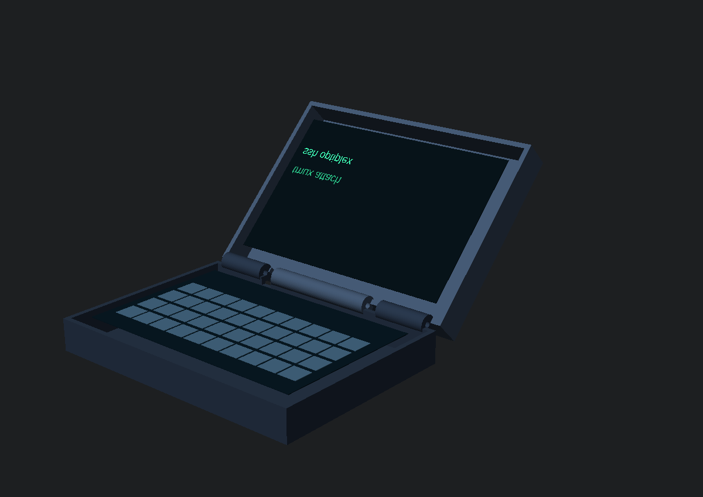

# HS Pocket Dual Touch S2 — real two-screen clamshell design investigation

**Two-version product-family validation (2026-11-06):** [Phone vs dual-touch cyberdeck demand, current competitors and HS engineering go/no-go](market/PHONE_CYBERDECK_MARKET_VALIDATION_2026-11-06.md).

**Market validation study (2026-11-06):** [Dated demand, local Taiwan/Indonesia resale comparisons, buyer segmentation, and honest NT$ unit economics](market/DEMAND_AND_ARBITRAGE_2026-11-06.md). Adjacent pocket-computer crowdfunding has real backers; no exact dual-touch sale or regional sell-through has yet been established. This research does **not** authorize procurement or product release.


**2026-11-06.** Product target: inexpensive, pocketable, calculator-size, ordinary **visible mechanical hinge**, **4.3-inch touch LCD in BOTH halves**, upper showing a remotely connected Optiplex terminal and lower a reconfigurable touchscreen keyboard. **Not a foldable OLED**, not an x86 mini-PC, and not two panels stitched into one impossible seamless screen.

**Current result: SOURCE-SUPPORTED SOFTWARE/CAD DESIGN ONLY. No board bought, connected, powered, flashed or used for SSH.**



## The crucial manufacturer finding: both screens already contain a CPU and serial interface

[Waveshare ESP32-S3-Touch-LCD-4.3](https://docs.waveshare.com/ESP32-S3-Touch-LCD-4.3) SKU25948, TOUCH version is nominal **106.1×67.8 mm**, **800×480 IPS capacitive touch**, ESP32-S3 N16R8 (16 MB flash / 8 MB PSRAM), 2.4GHz Wi-Fi, board 5 V **450 mA manufacturer-rated nominal consumption**, and **onboard SP3485 RS485 transceiver** with **HY2.0 2-pin A/B** connector and auto-direction switch; vendor GPIO15 TX and GPIO16 RX.

**Why this matters:** two modules can have **independent RGB panel drive**, independent capacitive touch buses and independent LVGL user interfaces. The ordinary hinge need only carry a **small low-speed RS485 differential pair plus appropriate common ground** (and, later if safe, regulated power). **No high-speed LCD FPC through the hinge.** For a first proof, each module receives 5 V from its **own designed USB-C input**; do not improvise feeding undocumented board pins.

One ESP32-S3 alone **cannot independently drive two identical 800×480 RGB panels using two native RGB LCD peripherals**: its capability record has **one RGB panel**. An additional different SPI display might still work in principle, but would require a different pin/driver/display architecture. [Espressif SoC capability docs](https://docs.espressif.com/projects/esp-idf/en/release-v5.3/esp32s3/api-reference/system/soc_caps.html).

### Interface and functionality pipeline

| Subsystem | Component / existing software | Functional responsibility | Current confidence |
|---|---|---|---|
| Upper screen | Waveshare ESP32-S3 4.3 touch | 800×480 SSH terminal, Wi-Fi 2.4 GHz, libssh2 | Source-compatible **concept**; no target build |
| Lower screen | Identical Waveshare ESP32-S3 touch | 800×480 LVGL virtual keyboard with extra Ctrl/Esc/Alt/Tab/arrows/terminal symbols | [LVGL keyboard](https://lvgl.io/docs/open/widgets/keyboard) exists; custom PTY events are NOT built |
| Hinge data | Both boards' existing SP3485 RS485 ports, 2-pin vendor connector | Half-duplex packets, seq/CRC/ack, virtual-key events only; optional screen mode commands | Manufacturer lists parts; **no physical bus test** |
| Power | Two known board USB-C inputs | 2 × 5 V 450 mA nominal = **4.5 W**, 5 V 2 A bench source candidate | No actual voltage, peak draw or thermal measurement |
| Folding case | **Existing** native HS Mecha-Splicer \`clamshell_terminal\` primitive | Two FDM shell halves + 3-knuckle 2mm pin hinge | CAD geometry audited, **not physically fitted** |
| SSH security | [PocketSSH](https://github.com/0015/PocketSSH) libssh2 port (currently T-Deck Plus 320×240) | Transferable client/PTTY implementation but hardware driver differs | **NOT SAFE AS IS**: upstream README acknowledges **no server host-key verification** |
| SSH host trust | [libssh2_hostkey_hash SHA256](https://libssh2.org/libssh2_hostkey_hash.html) | Independently provisioned 32-byte pinned key, compare before any auth | Contract proposed; **not ported or authenticated** |

**Do not wire the Waveshare RS485 A/B connector straight into 3.3V GPIO or an I²C level shifter.** The onboard RS485 hardware already converts serial signaling; verify terminal A/B orientation, termination/bias, common ground reference, UART framing (GPIO15/16), and current 5V input. No full electrical wiring diagram exists until the exact board revision and connector orientation are verified. An unconstrained single GND-less A/B cable may exceed RS485 transceiver common-mode limits.

The lower controller does **not** require Wi-Fi access or SSH passwords; its role is touch-to-key-event, delivered to the upper controller over RS485. No credentials shared across hinge. The upper controller connects to the Optiplex over an authorized LAN/VPN gateway (e.g. Tailscale-connected gateway); an ESP32 itself does **not** automatically implement the Tailscale client.

## Native HS outputs executed on the connected Optiplex

The dual spec [\`dual_touch_spec.json\`](dual_touch_spec.json) is validated by the **existing Mecha-Splicer** \`ProjectSpec\`, passed through its **existing** \`generate_bundle\`, DFM and BOM, and extended with an optional dual-touch mode in the already-implemented clamshell primitive (not a new viewer or independent CAD app).

- [\`base_shell.scad\` + \`lid_shell.scad\`](evidence/native_mecha/) and actually CGAL-exported binary **STLs**, each with **0 non-manifold edges**.
- **Six actual OpenSCAD CGAL boolean no-intersection tests** at angles 0, −30, −60, −90, −135 and −165 degrees, recorded in [\`design_evidence.json\`](evidence/native_mecha/design_evidence.json). These sample geometry poses; they **do not** prove continuous hinge fatigue, real pin fit, drag, strain relief, stiffness or board fit.
- **\`dual_touch_visual_preview.scad\`** with two nominal 106.1×67.8mm touch-module mock surfaces, the bottom displaying symbolic key tiles. The [PNG preview](evidence/native_mecha/dual_touch_visual_preview.png) was actually rendered by OpenSCAD + Xvfb, **not by working device firmware**.
- An actual **HS canonical \`MachineProject\`** of two screens, mechanical halves, RS485, USB power and SSH with traceable requirements/interfaces. Its [\`assess_release()\`](evidence/native_mecha/hs_release_assessment.json) correctly finds **\`design_ready\`, not operationally authorized**, with safety and unresolved-connection blockers. [Full canonical project graph](evidence/native_mecha/machine_project.json).
- [\`keyboard_link_reference.py\`](keyboard_link_reference.py) validates a **pure Python**, **NOT embedded firmware**, proposed key-to-PTY mapping (Ctrl+C/D/B, Esc/Tab/Enter/arrows), RS485 serial-frame CRC/sequence/ack/dedup contract, and a fail-closed SHA256 pinned-host-key comparison contract. It uses **no live UART/network/SSH**.
- [\`budget.json\`](evidence/native_mecha/budget.json) derived from seller *asking prices* and explicitly unquoted assumptions. No stock, order, invoices or printing occurred.

### Nominal enclosure and real Z risk

Printed shells **120 × 85 mm**, original design target **29.6mm closed shell-height envelope**, rear hinge adds ~5.2mm projection. Both touch-module published **XY planforms** fit in current printable trays by bounding calculations. **Vendor PCB stack height, glass-to-glass clearance, USB cutouts, antenna, module screw holes and real lower-screen orientation are unknown.** Two assembled touch boards could force a thicker case. No claim that this is as thin as a folding calculator.

## Taiwan parts budget and alternatives (not a purchase order)

From [iCShop listing](https://www.icshop.com.tw/en/products/368031700131) and [manufacturer source](https://www.waveshare.com/esp32-s3-touch-lcd-4.3.htm):

| Dual identical RS485 trial (recommended first) | NT$ | Basis |
|---|---:|---|
| 2× 4.3-inch Waveshare touchscreen/ESP32-S3 | 2,500 | Two at listed **NT$1,250 asking price**, availability not confirmed |
| RS485 2-pin cable + ground/reference | 85 | Assumption; vendor includes HY2.0 cables |
| Extra hinge-flex routing/protection | 70 | Assumption |
| Steel 2mm hinge pin | 45 | Assumption |
| Two printed PETG trays | 140 | Assumption; not slicer-quoted |
| Dual USB-C first-test power/cables | 125 | Assumption |
| **Provisional total** | **2,965** | **Excludes shipping, battery, labor, material retries, tax** |

**Comparison:**

| Architecture | Why/why not | Price confidence |
|---|---|---|
| Previous physical CardKB keyboard + 4.3 screen in [PR #290](https://github.com/Spectating101/hardware-splicer/pull/290) | Least firmware/voltage/workflow change, tactile keys, **NT$1,994** prior budget | Unquoted parts; keyboard and screen local availability unverified |
| **2× identical 4.3 ESP32-S3 touch + onboard RS485 (this study)** | Lowest integration uncertainty for **two equal capacitive touch panels**; cheap interface, common platform, one firmware base with top/bottom role | **NT$2,965 provisional** |
| 2× same boards with BLE HID instead of serial | No data cable, but separate battery charging, pairing/link recovery, Wi-Fi coexistence, more software; Espressif supports HID/coexistence but no actual SSH integration | More than wired once batteries/tools included; unquoted |
| 1 ESP32-S3 driving **two 4.3-inch native RGB panels** | Hardware has **one RGB LCD panel peripheral**, so not directly realizable. Could mix a separate SPI lower display but this is **not** the same two-panel circuit | **Reject as drop-in shortcut** |
| 1 upper 4.3 + 3.5-inch SPI resistive screen plus controller | [iCShop SPI 3.5-inch resistive touch screen ~NT$580](https://www.icshop.com.tw/categories/tft), local MCU/controller and pin/driver wiring extra, lower-resolution/mismatched glass | Potentially cheaper, **unknown** actual integration cost, not selected |
| Raspberry Pi Zero 2 W + distinct HDMI/DSI/SPI screens | Real Linux SSH and software keyboard easier; small Linux device, but extra drivers/ribbons/cables and screen cost; not an ESP32 budget panacea | [Pi Zero 2 W NT$609](https://piepie.com.tw/purchase) **before** screens and hardware, no delivered dual-display quote |
| Donor 2 old phones | Could be cheapest if genuinely owned already; battery/OS/third-party Bluetooth keyboard app constraints and physical thickness | No source or stock, **not a recommended assumed NT$0 purchase** |

At screen resolution 800×480, a theoretical 8×16 pixel monospace font gives **100 columns × 30 rows** on the upper half. Physical readability, font antialiasing, ANSI terminal handling and latency remain untested. Lower virtual keyboard keys would be ~9–10mm wide at ten columns on a ~95mm-wide panel; still much less comfortable than a tactile keyboard for prolonged typing.

### Battery sanity, not a power-system design

Manufacturer's indicative draw is **5V × 450mA × 2 = 4.5W**, excluding unmeasured peak/transients. A hypothetical **one 3.7V 4000mAh** rated cell has **14.8Wh nominal stored energy**, at most 3.3h at ideal 100% conversion (real runtime lower); **DO NOT connect one cell to both onboard CS8501 chargers**, parallel battery outputs or inject power through arbitrary pins. Battery compartment, BMS, charging topology and thermals require an actual design. For first proof, use safe, separate USB power inputs and verify ground.

## Three decisive HS gates / next engineering steps

1. **Firmware before pretty case**: make each unmounted Waveshare touchscreen work with its own manufacturer's ESP-IDF/LVGL samples, then confirm the two onboard RS485 ports exchange structured key events with correct ground reference, A/B and send/receive switch.
2. **Secure terminal behavior**: port PocketSSH display to 800×480 and implement host-key pinning; reject wrong keys **BEFORE any credentials**. Use LVGL keyboard with custom PTY control mapping; bench test Ctrl-C/Ctrl-B (tmux), Tab, Esc, arrows, backspace, reconnect and multiple character rows. Use an authorized SSH test server, never commit user secrets.
3. **Physical engineering**: once the exact boards are measured, add mounts, port access, glass flush condition, cable strain relief, hinge pin retention, then print and physically verify folding, cable fatigue, 5V draw, screen sleep and battery routing.

**Stop condition:** the CAD and data contract pass, but the existing HS MachineProject **does not authorize physical construction or use of an unverified power configuration**, and the off-the-shelf PocketSSH source does **not** safely verify SSH server identity. These are real technical blockers, not generic risk badges.

### Reproduce (without devices)

From repo root with OpenSCAD available:

```bash
PYTHONPATH=apps/mecha-splicer/src python3 \
  examples/cyberdeck/dual_touch/run_dual_touch.py --openscad /usr/bin/openscad

PYTHONPATH=apps/mecha-splicer/src:apps/mecha-splicer:src \
  pytest -q examples/cyberdeck/dual_touch/tests/test_dual_touch.py \
    examples/cyberdeck/tests/test_clamshell.py \
    apps/mecha-splicer/tests/test_bundle.py \
    tests/test_machine_project.py \
    tests/test_circuit_synthesis_planners.py
```

On the connected Optiplex I used the pre-existing OpenSCAD 2021.01 AppImage, not a fabricated geometry report. The earlier [October 2026 real cyberdeck backend trial](https://github.com/Spectating101/hardware-splicer/blob/experiment/hs-cyberdeck-physics-20261021/projects/cyberdeck-real-trial-20261020/README.md) already identified genuine HS engineering/source-ingestion gaps; those are explicitly preserved here rather than falsely claiming autonomous circuit and firmware completion.

**Net conclusion: yes, use HS.** Its mechanical generator and cross-discipline release gate can genuinely screen this dual-touch concept. The next defensible gain must be **actual target firmware and interface tests on hardware**, not another self-congratulatory CAD mock-up.
