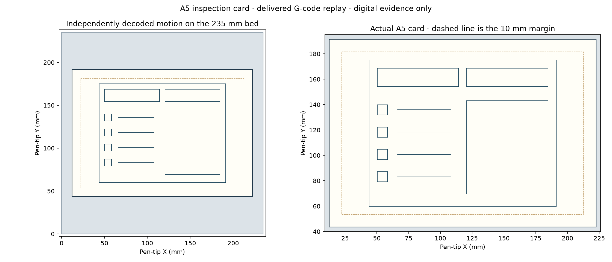
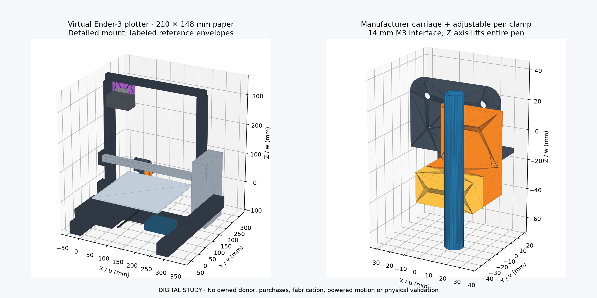

# A5 electronics inspection-card plotter

**Completed digital build through the real HS registered-project engine.** The same saved project was built for a 10 mm pen, revised for a 12 mm pen and A5 paper, audited natively, and exported. The final delivery passed 150 independent checks and all three semantic negative controls.

[Final study ZIP](deliverables/a5-inspection-card-study.zip) · [Baseline ZIP](deliverables/baseline-study.zip) · [Actual run ledger](evidence/structured-run/run-ledger.json) · [Independent audit](evidence/independent-audit.json)



## What was built

The card has one closed outer border, two blank header fields, four square checkboxes with writing lines, and a clear board-sketch area. Artwork was explicitly authored as structured vector input. HS generated the mechanical parts, full-device reference assembly, motion program, replay, engineering reports and sealed packages.

| Setting | Baseline, revision 1 | Final, revision 2 |
| --- | ---: | ---: |
| Paper | 180 × 180 mm | A5 landscape, 210 × 148 mm |
| Drawing viewport capacity | 100 × 80 mm | 190 × 128 mm |
| Fitted source canvas | 100 × 80 mm | 160 × 128 mm |
| Pen diameter | 10 mm | 12 mm |
| Pen lift | 3 mm | 3 mm |
| Checkbox dimensions | 5 × 5 mm | 8 × 8 mm |

The source canvas is fitted uniformly and centered within the available viewport. Its internal whitespace makes the final ink footprint **147.2 × 115.2 mm**. The closest ink is **16.4 mm** from a paper edge; the complete requested viewport reserves at least 10 mm.

The final ZIP contains 47 files, including:

- Editable STEP and STL for the pen adapter, clamp cap and hotend parking plate.
- Full-device STEP and GLB, with detailed donor carriage geometry and labeled reference envelopes for simplified retained parts.
- SVG, G-code, complete trajectory CSV and replay image.
- Requirements, engineering/simulation/verification reports and full artifact hashes.
- Build, simulation and independent native verification scripts.
- Assembly/reversion instructions, parameterized BOM, source provenance and retained manufacturer documents.

The case BOM includes defaults for general reuse. For this revision, resolve the selected pen to **12 mm**, the paper to **210 × 148 mm**, and the 0.5 mm EPDM liner cut length to **π × 12 + 2 = 39.70 mm** (20 mm wide). The delivered bores have radius 6.6 mm, including the documented 1.2 mm diametric liner allowance. These are design specifications, not purchased or tested components.



## What HS actually did

The [credential-free runner](run_structured_trial.py) called the production `DigitalStudyEngine`:

1. Created a registered Ender-3 project from validated requirements and authored vector strokes.
2. Built and exported the baseline.
3. Ran a numeric revision against the same persisted project.
4. Compared revision history and confirmed byte-identical archived artwork.
5. Ran the native CAD/motion audit and exported the revised study.

Project: `digital-03a366b83b1c42ca900a5799ced2704c`, revisions **1 → 2**.

Build source: `588b3b3e1c728bede4a5d7b7d0b5ae38c2e6e3a6`.
The structured run completed on **2026-11-19 at 00:06 Taipei** in about 30 seconds. Timings and every API result are retained in [the run evidence](evidence/structured-run).

The complete code snapshot combined the earlier GitHub review branch with the then-current Optiplex project workflow. Its [input manifest](../../docs/reviews/HS_A5_BUILD_INPUT_SNAPSHOT_20261118.json) records captured files and hashes. The original active checkout was not changed by this trial.

### Text-provider limitation

The original [prompt runner](run_trial.py) was tried first. Copilot reported a quota limit; configured Qwen returned an HTTP error; agy exited unsuccessfully. Each stopped before project creation. [All three original attempt records are retained](evidence/provider-attempts/attempt-summary.json).

The successful run supplied the drawing and requirements directly. It did **not** invoke or mock a text provider, and it does **not** establish that prose-to-design was functioning during this trial. The archived filename `sources/prompt-drawing.json` is the engine's existing source-artifact name, not a claim of LLM authorship.

## Improvements made through this trial

**Explicit paper geometry.** The case previously assumed a 180 mm square sheet. The registry and native build now accept paper width/height, produce the requested sheet in STEP/GLB/render output, and check the actual reopened geometry. Historical four-setting inputs retain their 180 mm defaults. Horizontal viewport capacity expands to 190 mm while the manufacturer bed and controller limits remain unchanged.

**Preserved artwork proportions.** Independent X/Y scaling would have turned the square checkboxes into 9.5 × 8 mm rectangles. The production mapping now uses `min(width / 100, height / 80)`, centers the result, and records fitted canvas dimensions separately from viewport capacity. The default 100 × 80 mm case remains unchanged.

Production source-to-SVG-to-G-code verification uses the same intended geometry independently. The separate delivery checker reopens exported data and CAD without executing packaged authoring code.

## Verification results

| Actual delivery measurement | Result |
| --- | --- |
| Native paper geometry | 210 × 148 × 0.1 mm, STEP and GLB agree |
| Artwork retention | Identical source bytes across revisions |
| Mounting interface | Original 14 mm M3 center pair retained |
| Pen grip revision | Both native bores changed from radius 5.6 to 6.6 mm |
| Clamp gap | 0.4 mm |
| Adapter/cap overlap with detailed carriage | 0 mm³ |
| Motion | 12 strokes, 36 ink segments, 73 linear moves |
| Pen-down distance | 1,408 mm |
| Pen-up XY distance | 591.106 mm |
| Ideal feed duration | 189.555 s, excluding acceleration and settling |
| Independent delivery audit | 150 checks passed, zero failures |
| Focused code tests | 44 passed; two existing deprecation warnings |

Sources: [delivery audit](evidence/independent-audit.json), [native audit](evidence/structured-run/06-native-audit.json), [test receipt](evidence/focused-tests.log).

The [negative-control harness](check_negative_controls.py) changed temporary copies of the actual output, then recomputed seals so rejection depended on geometry or motion rather than stale hashes:

| Deliberate defect | Independent rejection |
| --- | --- |
| Substitute the authentic 180 × 180 baseline assembly into the A5 package | Actual STEP and GLB paper dimensions |
| Reduce first XY travel lift from 3 mm to 1 mm and update the CSV | Required travel lift |
| Restore X-only stretching while remaining inside the viewport | Source/G-code segment identity and all four square-checkbox dimensions |

All three controls passed and both original ZIPs remained unchanged. See [the complete control receipt](evidence/negative-controls.json).

The assistant also visually inspected the rendered assembly and independently decoded card preview. The card's blank fields, four separated square checkboxes/writing lines and right-side sketch area are visible without overlaps. See [visual review](evidence/visual-review.json).

## Reproduce or inspect

From the full repository, use its application Python and existing native CAD environment:

```bash
export HARDWARE_SPLICER_DIGITAL_PYTHON=/path/to/hs-native/bin/python

.venv/bin/python -B projects/a5-inspection-card/run_structured_trial.py \
  --state-root /tmp/hs-a5-trial-new

"$HARDWARE_SPLICER_DIGITAL_PYTHON" -B \
  projects/a5-inspection-card/check_delivery.py \
  /tmp/hs-a5-trial-new/a5-inspection-card-study.zip \
  --baseline /tmp/hs-a5-trial-new/baseline-study.zip \
  --output /tmp/hs-a5-trial-new/independent-audit.json \
  --png /tmp/hs-a5-trial-new/independent-preview.png

"$HARDWARE_SPLICER_DIGITAL_PYTHON" -B \
  projects/a5-inspection-card/check_negative_controls.py \
  /tmp/hs-a5-trial-new/a5-inspection-card-study.zip \
  --baseline /tmp/hs-a5-trial-new/baseline-study.zip \
  --output /tmp/hs-a5-trial-new/negative-controls.json
```

Use a fresh state directory. No text-provider credentials are needed for this reproduction. Generated timestamps can change archive hashes; evaluate the engineering checks and recorded requirements.

The Projects UI reads controls dynamically from the saved requirements and registry bounds, so the new paper fields are available for new paper-aware projects. This was confirmed by source inspection, not a browser session.

## Scope remaining

This is a completed **digital study**, with no physical printer, fabrication, purchase, homing or powered motion performed. Whole-machine geometry includes labeled reference envelopes. Physical pen retention/force, printed material strength, harness routing and whole-machine collision clearance remain unverified. The new tip sits 30.75 mm below the source nozzle tip, so an actual build needs its own measured Z-limit and paper-datum acceptance before any machine use. The package's assembly document details those limits.

### Reference archive hashes

```text
b55b12339b84e2732990091b7d27dfce455158085e521a244e41db63d8bf103f  a5-inspection-card-study.zip
93428326edd47048714a6ef9892391ac0a3e9757e63ed0b5272a64e918ab1387  baseline-study.zip
```
