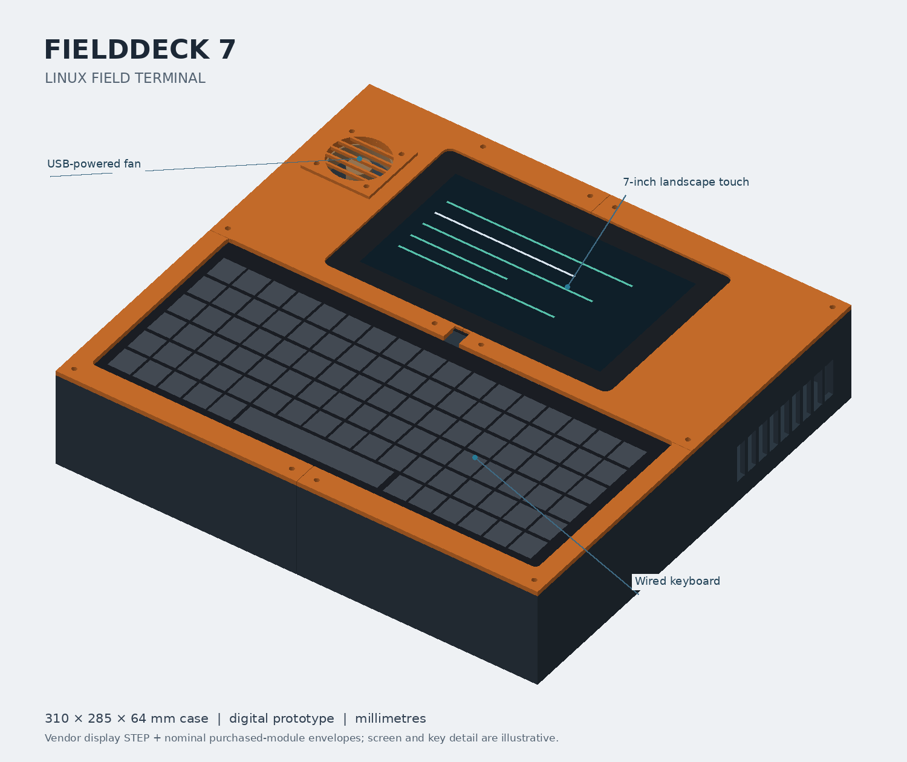

# Fielddeck 7 — engineered digital cyberdeck prototype

An editable device design for a portable **Linux terminal, offline build-reference reader, SSH machine and light coding station**. It combines a Raspberry Pi 4, 7-inch landscape touchscreen, wired keyboard, removable commercial power bank and a modular printed case. This continues the original cyberdeck goal with an actual assembly rather than another backend feature.

**Digital scope:** CAD and first-order engineering calculations are complete for this revision. No physical device or booted simulation is claimed. Keyboard keys/screen content are illustrative and CAD colours distinguish parts; the selected spool is black. The assembly itself comes from the delivered geometry.

| Deliverable | Open |
| --- | --- |
| Editable solid assembly | [FIELDDECK_7.step](cad/FIELDDECK_7.step) |
| 3D viewer model | [FIELDDECK_7.glb](cad/FIELDDECK_7.glb) |
| 20 individual printable parts, STEP and STL | [cad/print](cad/print) |
| Exploded / internal / dimensioned views | [Exploded](views/exploded.png), [internal](views/internal.png), [drawing](views/dimensioned_layout.png) |
| Exact commercial modules and standard hardware | [BOM.csv](BOM.csv), [bom.json](bom.json) |
| Matching build and connection plan | [ASSEMBLY.md](ASSEMBLY.md), [CONNECTIONS.md](CONNECTIONS.md), [diagram](views/connections.svg) |
| Power/runtime and structural/airflow calculations | [calculations.json](analysis/calculations.json), [power plot](analysis/power_runtime.png) |
| OS, installation and future bring-up scripts | [software](software/README.md) |
| Actual exported geometry verification | [verification.json](analysis/verification.json) |

## The device

The case is **310 × 285 × 64 mm**, with 6 mm feet and a 2 mm fan guard outside that envelope. Four tray quarters and four face pieces fit individually on a 220 mm printer. A 7-inch Touch Display 2 uses the publisher's MIT-licensed STEP and measured mounting geometry. The keyboard and bank have purchased-part envelope models based on their published dimensions. Pi USB/Ethernet face the rear; two USB 2 ports serve keyboard/fan and two USB 3 ports remain available within the power limits. External USB service loops need rear clearance.

Selected identities: Pi **SC0193** (2GB), display **SC1635**, Adafruit keyboard **1736**, Anker **A1259**, Noctua **NF-A4x10 5V PWM**, SanDisk **SDSQXCG-032G-GN6MA0**, Adafruit **1648** display FFC and **824** power extensions, StarTech **USB2CC50CM**. Links and acquisition status are in the BOM. There is no custom PCB: this device's engineering work is integration, mounting, connections, power, service access and enclosure design.

## What the calculations say

- **Ordinary terminal scenario:** 8.25 W, estimated **2.78–3.93 h**. Light scenario: 3.53–4.98 h. Stress allocation: 1.82–2.57 h. These use assumed Pi/keyboard consumption, 36 Wh nominal cell energy, 75–90% conversion and 85–100% usable capacity. They are not measured runtime.
- **Power boundary:** the bank supplies **5 V, 3 A** per selected port. Stress allocation is 2.52 A; with a 0.5 A keyboard sensitivity it becomes 2.92 A, leaving little margin. Pi USB ports also share 1.2 A. Extra powered disks/radios need a separate budget or self-powered hub. Cable/contact resistance can cause undervoltage even below 3 A.
- **Cost reference:** approximately **$337** including a full PETG spool and explicit hardware/cable allowances, before tax, shipping, printing labour and tools. Live-observed prices are separate from allowances. The old $250 trial target was evaluator-imposed and is not met here; no user budget/country was assumed. This is a dated parts reference, not a shopping order.
- **Mechanical check:** each ideal display post carries about 1.72 N in a 2 g lateral scenario with an assumed 350 g panel; about 1.0 MPa bending stress and 0.11 mm deflection. This excludes layers, joints, screws, seams, glass and impacts; it is not FEA or a drop rating. Solid CAD PETG upper bound is about 840 g; actual sliced mass is unknown.
- **Cooling check:** at 12.6 W assumed heat, bulk air rise ranges about 4–21°C if delivered flow is 100–20% of the fan's 8.9 m³/h free-air figure. The real operating point and CPU junction temperature have not been solved. The duct and exhaust are geometrically provided, not thermally validated.

## Verification and remaining uncertainty

The delivered CAD was iterated after actual intersections were found at keyboard supports, the rear Pi I/O fixing and a seam plate. The glass needed an underside bezel recess. The original log is retained as `cad/iteration_01.json`; its two display-post overlap reports were later identified as coincident-face artefacts, and the check now counts closed intersection solids only. Current checks cover rigid part interference, closed/valid exported solids, printable meshes, bed limits and mounting-hole paths. Flexible cables, fasteners and full purchased-module detail are not part of the collision model.

The largest remaining fit uncertainties are the bank's unpublished port/button placement, the keyboard underside/pad stack, nominal display lug thread engagement, and flexible leads. The GPIO extension's 28 AWG copper drop can be estimated, but its contact rating/retention remains provisional. Actual printing, input-voltage/load testing, cooling, touchscreen alignment and ARM boot were not performed because this project is digital only.

## How this relates to Hardware Splicer

This is **assistant-directed engineering using specialist CAD tools**, with the existing HS project/source/material services used to save and inspect the result. It is not evidence that HS autonomously designed a complete device. [HS receipt](analysis/hs_receipt.json), [native STEP reading](analysis/hs_source_check.json) and [material reconciliation](analysis/hs_materials.json) are retained. The user owns no parts, so the real inventory is empty and all materials correctly remain to acquire or make. Retail availability is never treated as owned stock.

The old October temporary store no longer exists. `hs_project/` is a durable recovery of the same objective, with fresh revision history; the original trial's verdict is preserved. No frontend, backend production module, purchase, fabrication or hardware action was added by this device package.

## Regenerate

Use Python with `cadquery==2.6.1`, `trimesh==4.12.2`, `numpy==2.5.5`, `matplotlib==3.11.2`, `Pillow==13.0.0`, `CairoSVG==2.9.1`. The existing repository environment is `.cache/hardware-splicer/digital-native-venv/bin/python`. Run `author_cad.py`, `engineering.py`, `render_device.py`, then `verify_device.py` in that interpreter. Use the repository `.venv/bin/python save_hs_project.py` for the existing HS services, then run `package_device.py` in the CAD interpreter for the distributable ZIP and rendered connection diagram. No LLM/API credential is required. Review `design.json` and the layout constants in the authoring code together; changing a case dimension does not automatically rearrange every module.

The Raspberry Pi display STEP is redistributed with [its MIT license](sources/touch_display2_LICENSE.txt). Primary documents, source URLs and source hashes are recorded in [sources/references.json](sources/references.json); other manufacturer PDFs/HTML are local research captures, excluded from the distributable package.
