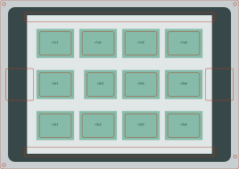

# P217 · Tablet keyguard for a 12-button board

This trial turns a specified button layout into a removable, keyed overlay for a bare ninth-generation iPad in landscape orientation. Selecting a button on the [offline trial board](board-r2.svg) highlights the selection. The board is an HS-authored test layout. A customer's app, screen orientation and case would need their own geometry and fit check.



The model caught a design problem. Side gesture slots extending 8.5 mm into the display left only 4.883 mm of material between the slot and its neighboring button opening after cut allowance. The design calls for 5 mm. Reducing the slot reach to 7.5 mm increased the minimum ligament to **5.883 mm** while preserving **5.719 mm** of modeled inward gesture travel at the center of each edge.

## Digital evidence

Apple lists a 250.6 × 174.1 × 7.5 mm body, a 2160 × 1620 display and 264 pixels per inch. These figures imply an active rectangle of 207.818 × 155.864 mm. The trial assumes the rectangle is centered in the housing and uses the full display. The design origin is the top-left of the backing, with the Home button on the right. Display centering, absolute scale, actual corner profiles and the completed assembly require measurement on the named device. [Apple specifications](https://support.apple.com/en-us/111898)

| Check on exported files | Result |
|---|---|
| Every opening contained in its assigned button over the modeled error envelope | 12 of 12 on each revision. The smallest residual in-plane margin is 1.419 mm. |
| Smallest central circular access area | 25.912 mm in diameter after cut allowance, against a 20 mm design criterion. |
| App revision moved the left edge of “Less” by 56 pixels (5.388 mm) | The old opening crossed the revised button edge by 2.188 mm at nominal alignment. Regenerating changed exactly one of 12 openings. |
| Guard shifted 5 mm, screen shown at 90% scale from top left, or screen rotated 180° | Each control put all 12 openings partly outside their assigned targets. |
| Asymmetric M3 hole pattern shared by backing, locator and guard | Four holes aligned. Rotating the guard 180° left one hole 9.5 mm from the nearest mating hole. The minimum modeled material between a fixing hole and an interior cut is 2.05 mm. |

The checks reread the saved SVG contours, compare their envelopes with the rendered board's target rectangles in millimetres, and test the deliberately mismatched combinations. The in-plane budget assumes at most 0.4 mm of body movement at the reference center, 0.45 mm of screen-center error, 0.30 mm of residual alignment movement at the fixings, 0.20 mm of cut error per edge and ±0.15° total yaw. The angular bound uses the furthest corner of the entire plate and allows every intermediate rotation. The resulting bound is 1.781 mm per axis. These are **as-built limits to check**. A loose screw assembly or an oversized locator can exceed them. Rounded aperture bounding boxes make the containment test conservative. Wear, strength, optical parallax, grip, actual touches and user access still require physical evaluation.

## Open or reproduce

The cut files contain closed contours in millimetres and a 268.6 × 190.1 mm overall envelope. All SVG strokes in the fabrication drawings represent toolpath centerlines. The kerf compensation choice belongs to CAM. The colored inspection drawing is a separate reference view.

- [Editable device, tolerance and layout dimensions](design.json)
- [Revision 1 board](board-r1.svg) and [matching overlay](guard-r1.svg)
- [Revision 2 board](board-r2.svg) and [matching overlay](guard-r2.svg)
- [Backing](backing.svg), [tablet locator](locator.svg) and [digital results](results.json)

Run from any working directory by passing the path to [study.py](study.py). Python 3.9 or later can generate and verify the complete set with its standard library. Run without Python's optimization flag so the acceptance assertions execute.

```sh
python3 projects/engineering-opportunity-portfolio/catalog/engineering/P217/study.py
```

## Trial assembly and physical acceptance

1. Cut a full-size paper overlay first. In the fabrication program verify that the outline measures 268.6 × 190.1 mm. Display the matching board at the full-screen 4:3 extent. Check the location of the Home button, camera, body edges and all twelve targets on the actual tablet. A browser toolbar, letterboxing, zoom or a case changes registration.
2. For the bench fixture, use a flat backing, a low-profile locator and the guard. The locator drawing has a nominal 251.4 × 174.9 mm pocket for the bare housing. A candidate stack is a 3 mm backing, one 3 mm locator and a 2 mm clear cast acrylic guard. Use suitable stock and CAM settings for the available fabrication process. Smooth contact edges and keep fastener ends and cut surfaces away from the screen. The 3.5 mm clearance holes accept four M3 fixings situated outside the body footprint.
3. With a 0.5 mm measured backing pad and nominal 7.5 mm body, an initial 9 mm spacing from backing top to overlay underside leaves approximately 1 mm above the glass. Measure the actual gap free and under the intended hand load. Raise or support the guard if it flexes into the glass. Determine force, edge finish and secure retention with the real assembly. The three-sheet cradle is a proposed bench fixture. A commercial case attachment needs its own reference.
4. Measure registration at the four corner targets and record the bounds above through five removal/refit cycles. Check the entire window boundary at each extreme. On the actual app, exercise every target and each edge gesture. Observe unintended selections, failed selections, contact with adjacent cells and access to the Home button. Record which layout and case were tested. The physical fitting and intended user's review determine suitability.

## Effect on the business case

The archive budgets NT$195 in parts, 22 minutes of repeat assembly, five engineering hours and NT$650 prototype expense. At NT$1,250 per sale, the modeled contribution is NT$492.50 and profit on 25 identical units is NT$8,662.50. An additional **34.65 minutes of fitting per order** at NT$600/hour consumes the entire batch profit. At 45 extra minutes per order the same batch loses NT$2,587.50. Generating a one-button revision establishes which design work is reusable. Assembly minutes, user fitting time, material yield and acceptance are still unmeasured.

The proposed backing and locator consume two additional 268.6 × 190.1 mm stock envelopes per reusable shop fixture. Two extra sheets and hardware shipped with every guard would require a revised unit cost. As a sensitivity case, an extra NT$140 per delivered unit would leave NT$5,162.50 at 25 identical sales and lower the spare fitting time to 20.65 minutes per order. The NT$140 is an illustrative allowance pending supplier quotes.
