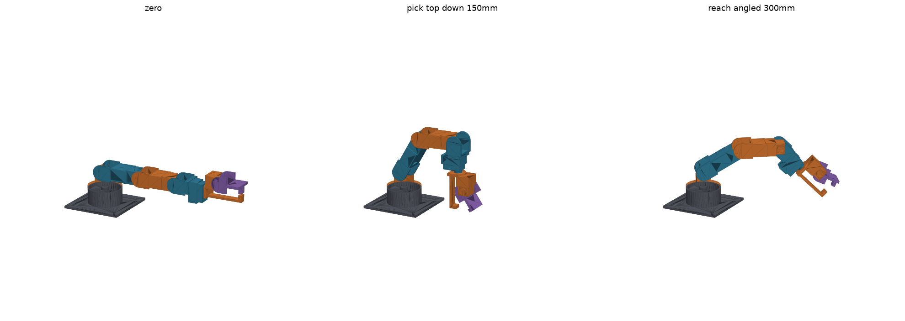

# HS-ARM-A: a 5-axis desktop arm with a gripper



An original arm designed end to end in this repository: requirement, actuator choice from cited data, printable parts,
assembly, URDF, collision sweep, workspace, power budget and a priced BOM. Nothing has been printed or built yet.

| Requirement (given) | Result | Where |
|---|---|---|
| Reach at least 300 mm | 376 mm from the yaw axis to the grasp point | `verification.json` reach_mm |
| 150 g payload, safety factor 1.5, at most 50% of stall torque (assumed derating) | shoulder 49%, elbow 29%, wrist 40% | static_torque |
| Prints on a 220 x 220 x 250 mm bed | 7 parts, all fit, each one solid, 322 g of PLA | parts |
| No self-collision | every joint swept over its limits, 0 clashes | `motion_sweep.json` |
| Pick from the table | any approach 125-365 mm out; straight down only 125-180 mm | pick_workspace |

## Parts

Joint servos (ROBOTIS e-manual figures): XM430-W350-T at base yaw, shoulder and elbow (4.1 N m stall at 12 V, 82 g);
XL430-W250-T at wrist pitch, wrist roll and gripper (1.5 N m, 57.2 g). Bus: U2D2 plus U2D2 Power Hub from a 12 V 5 A
supply, daisy-chained X3P cables. Priced in `BOM.json`: **US$1,089.50**, of which US$1,054.50 is cited from shop pages; the
three XM430s are 75% of it.

Printed in PLA (`print/*.step` and `.stl`): base housing with a support ring, turntable, upper arm, forearm, wrist,
gripper base with fixed jaw, moving jaw.

## What the checks changed in the design

* **Base bearing.** The arm's overturning moment on the base servo is 1.35 N m, 3.4x the horn's rated side load
  (40 N at 10 mm). The turntable therefore rides on a ring in the housing with a 1 mm PTFE washer, not on the servo.
* **Clamp the base.** A free-standing base (0.22 kg) cannot hold the stretched arm (0.16 N m restoring against 1.35 N m).
  Bolt it down through the four M5 holes or clamp it.
* **Wrist length.** The roll servo needs at least 68.3 mm behind the wrist-pitch axis; the build refuses anything shorter.
* **Gripper jaw.** The first jaw clashed with its own servo at 10 degrees; its bar now starts outside the servo's swing radius
  (18.2 mm) and the jaw opens 0-70 degrees clear. A first fixed jaw was a floating piece; the build now fails on any
  printed part that is not one body.
* **Joint limits** are the swept clear ranges less 5 degrees: shoulder -150..+15 (positive is down), elbow -105..+85,
  wrist pitch +/-105, yaw and roll +/-150.

## Power

Holding the stretched arm draws about 1.6 A (current scaled from the cited stall currents). All six servos stalled at once
would draw 11.1 A, over the power hub's 10 A rating and the 5 A supply; the servos' overload shutdown, not the supply, is
the protection in that case.

## Not modelled yet (check before printing)

* Horn bolt circle and servo side-screw holes: the parts have none. Take them from the real horn, or the ROBOTIS drawing
  (its download centre links were dead on 2026-11-26).
* Idler horn thickness (4 mm assumed).
* Part strength: no FEM on the links; PLA at 60% effective fill is assumed for mass only.
* Inertia is a box proxy; no dynamic or acceleration torque, no friction.
* Cable routing.

## Rebuild

```bash
NATIVE=.cache/hardware-splicer/digital-native-venv/bin/python
$NATIVE -I projects/hs-arm-a/build_arm.py                      # parts, assembly, URDF, verification.json
$NATIVE -I src/hardware_splicer/motion_sweep.py --urdf projects/hs-arm-a/urdf/hs_arm_a.urdf --steps 31 > projects/hs-arm-a/motion_sweep.json
python3 projects/hs-arm-a/workspace.py                          # pick workspace into verification.json
$NATIVE -I projects/hs-arm-a/render.py                          # renders/HS_ARM_A_POSES.png
```

Servo geometry: body dimensions from the ROBOTIS e-manual; horn diameter and its 12 mm offset measured from the XM430 in
ROBOTIS's OpenMANIPULATOR-X model (`link1.stl`, Apache-2.0). The arm itself is HS's own design, not a copy of that kit.

## Rev B: the same arm on Feetech STS3215 servos (2026-11-27)

Built by `build_arm.py --servo sts3215 --out rev-b`. The STS3215 is the SO-ARM100/101's servo. Its geometry is measured
from SO-ARM100's `STS3215_03a.step` (Apache-2.0, commit 141aea7b): body 45.4 x 24.8 x 35.4 mm, horn axis 12.5 mm from
the body centre, horn 10 mm radius and only 1.0 mm proud. Because the horn is nearly flush, each cheek plate is held out
by a printed boss (3 mm horn side, 4 mm idler side) so it clears the next link's cradle as in rev A; without it the
collision sweep found clashes at the elbow, wrist and gripper.

| | Rev A (X430) | Rev B (STS3215) |
|---|---|---|
| Reach | 375.9 mm | 370.5 mm |
| Moving mass | 0.516 kg | 0.456 kg |
| Shoulder, 150 g payload, safety factor 1.5 | 49% of stall | 66% of stall (over the 50% rule; about 63 g at the rule) |
| Elbow / wrist pitch | 29% / 39% | 39% / 19% |
| Joint ranges, collision sweep | clash-free | clash-free over the same ranges |
| Screw holes | none (drill from the real horn) | cut: horn and rear-disc screws, body screws |
| Parts | US$1,089.50 | US$206.49 (`rev-b/BOM.json`) |

The 50% rule is HS's own design assumption, not a published rating. The SO-101 follower, built in large numbers, needs
80% of its 7.4 V STS3215's stall at the shoulder with no payload by the same method (worst pose over its joint ranges,
safety factor 1.5, masses from its URDF), so rev B keeps more margin than the reference design does. Nothing has been
printed or built.

Rev B's printed parts carry their screw holes. Positions are measured from the STS3215 model: four 2.5 mm holes on a
9.8 mm square about the axis on both the horn and the rear disc, and 1.5 mm pilots (M2 self-tapping) on each body face.
Clearances copy SO-101's printed upper arm for the same servo: 3.0 mm horn holes, a 3.2 mm centre bore, 2.0 mm body
holes. Each horn hole has a 6 mm head recess open towards the servo pocket, so the turntable's and gripper base's screws
go in before the next servo and their heads sit clear of it; the base plate's body screws are counterbored underneath.
`verification.json` (`fasteners`) records which part each servo's holes cut, and a test holds every set to the part that
holds or is driven by that servo. The horn thread size is not in the model; screw heads are not in the collision sweep.

## Leader arm (2026-11-27, `leader/`)

The teleoperation input for rev B: the same arm moved by hand, so its joint angles drive rev B one to one (the URDF's
joint frames match rev B's apart from the gripper). It takes the low-ratio STS3215s SO-101's leader uses, per LeRobot's
table (Apache-2.0): 1/191 at the base and elbow, 1/345 at the shoulder so the arm holds its own weight unpowered, 1/147
at the wrist and the trigger so a hand can backdrive them. A handle hangs below the gripper bracket where the fixed jaw
was, and the gripper servo turns a short trigger, as SO-101's Handle and Trigger parts do.

| | Rev B follower | Leader |
|---|---|---|
| Servos | 6 x STS3215 12 V | 2 x C044, 1 x C001, 3 x C046 (7.4 V) |
| Collision sweep over rev A's ranges | clash-free | clash-free |
| Torque check | shoulder 66% of stall (over HS's 50% rule) | not applied: moved by hand with torque off |
| Parts | US$206.49 | US$125.71 (`leader/BOM.json`) |

Follower plus leader: US$332.20, against US$229.88 for SO-101's two-arm kit; most of the gap is rev B's 12 V servos and
supply. Nothing has been printed.

    .cache/hardware-splicer/digital-native-venv/bin/python projects/hs-arm-a/build_arm.py --servo sts3215_leader --out projects/hs-arm-a/leader
