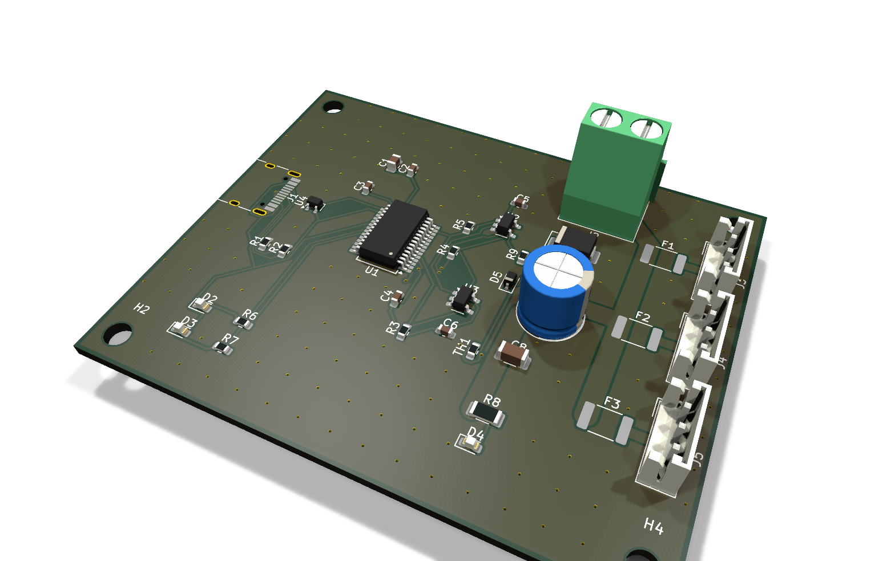

# HS-BUS-A: USB to DYNAMIXEL bus board for HS-ARM-A



A 70 x 56 mm two-layer board that replaces the ROBOTIS U2D2 and its power hub (US$51.10 together in
`../hs-arm-a/BOM.json`): USB-C to a half-duplex DYNAMIXEL TTL bus, and a 12 V input split into three fused servo ports.
Generated from `design.py` by `build_board.py`; nothing has been fabricated or powered.

| Check | Result | Where |
|---|---|---|
| Every symbol pin connected or declared unused | 119 pins, pass | `verification.json` schematic |
| KiCad's own netlist of the schematic equals the design | 22 nets, pass | schematic |
| KiCad ERC | 0 errors, 0 warnings | schematic |
| KiCad DRC with schematic parity | 0 errors, 0 unconnected, 0 parity differences; 2 warnings: the USB-C silkscreen crosses the board edge, where the port overhangs on purpose | drc |
| Logic levels guaranteed by datasheets | pass on every link | electrical.logic_levels |
| Parts at JLCPCB/LCSC, every line found | US$9.18 per board for one, US$8.37 each for ten (23 lines, prices of 2026-11-26) | bom_pricing |

## Circuit

* **USB:** HRO TYPE-C-31-M-12 (USB 2.0 only, 5.1 kohm CC pull-downs), TI TPD2E2U06 ESD array, FTDI FT232RL with
  5 V I/O. Its CBUS2 pin is TXDEN by factory default, so the transmit direction needs no EEPROM programming.
* **Half-duplex bus:** ROBOTIS's published TTL circuit (two tri-state buffers on one data line, 10 kohm pull-ups),
  with one change. ROBOTIS draws a 74LVC2G241, whose inputs need 3.5 V at 5 V supply, and the FT232R only guarantees
  3.2 V high. TI's 74AHCT1G126 (transmit) and 74AHCT1G125 (receive) take 2.0 V, so the margin is guaranteed.
* **Data-line protection, from Pollen Robotics:** 150 ohm series resistor, 5.1 V Zener and a 100 ohm resettable PTC
  (Murata PRG18BB101MB1RB, 24 V) between the buffers and the connectors, as in Pollen's production converter
  ([elec_grabette](https://github.com/pollen-robotics/elec_grabette), Apache-2.0). A cable that puts 12 V on the data
  pin then cannot reach the buffers.
* **12 V:** screw terminal (wire entry at the board edge), SMBJ15CA surge clamp, 220 uF bulk capacitor, power LED, and
  one Bourns MF-MSMF250/16X (2.5 A hold, 5 A trip) per JST B3B-EH-A port, inside the connector's 3 A rating.
  Tracks: 2.5 mm for the input (about 12 C rise at the supply's 5 A, IPC-2221, 1 oz copper assumed), 1.2 mm per port.

## What the checks found

* The ROBOTIS reference buffer is not guaranteed with an FT232R at 5 V (3.2 V out against 3.5 V in); hence the AHCT parts.
* A keyword parts search returned a white LED with a yellow lens for "0603 LED yellow". LEDs now carry LCSC codes, and
  the pricing marks every keyword match for a human to check.
* The 3D render showed the screw terminal's wire entry facing into the board; it is rotated to face the edge.
* FreeRouting could not finish while the board had a keep-out area and locked pre-routed power tracks; with every
  net routed in one pass, and the 12 V widths set as net classes, it completes.

## Power notes

* The arm's servos share a 10.0-12.0 V window (XM430 10.0-14.8 V, XL430 6.5-12.0 V). A 12 V supply is at the XL430's
  limit; do not use one that regulates high.
* The surge clamp conducts above 16.7 V and clamps at 24.4 V: it absorbs spikes, it does not protect against a wrong
  supply. The terminal has no reverse-polarity protection.
* Run the arm on two ports (yaw, shoulder and elbow on one, wrist and gripper on the other). A full stall of every
  joint (11.1 A) trips the fuses, which is the intended protection.

## Not checked

USB signal integrity (12 Mb/s full speed, short tracks, no impedance control), thermal behaviour of the fuses and copper
beyond the IPC-2221 estimate, firmware or host software (the board is an FTDI serial port for the DYNAMIXEL SDK), PCB
fabrication and assembly cost (the price above is parts only).

## Files

`kicad/` (schematic, PCB, project), `fab/` (Gerbers and drill files zipped for a board house, pick-and-place, BOM,
schematic PDF), `renders/`, `verification.json`.

```bash
HARDWARE_SPLICER_FREEROUTING_JAR=... PYTHONPATH=src .venv/bin/python projects/hs-bus-a/build_board.py
# after a field-only change (values, part numbers), keep the routed board and re-run every check:
PYTHONPATH=src .venv/bin/python projects/hs-bus-a/build_board.py --reuse-pcb projects/hs-bus-a/kicad/hs_bus_a.kicad_pcb
```

Parts data: JLCPCB's list via [jlcparts](https://github.com/yaqwsx/jlcparts) (`src/hardware_splicer/jlcparts_lookup.py`).
KiCad symbols, footprints and 3D models are read from the KiCad 9 libraries at build time, not stored here.
