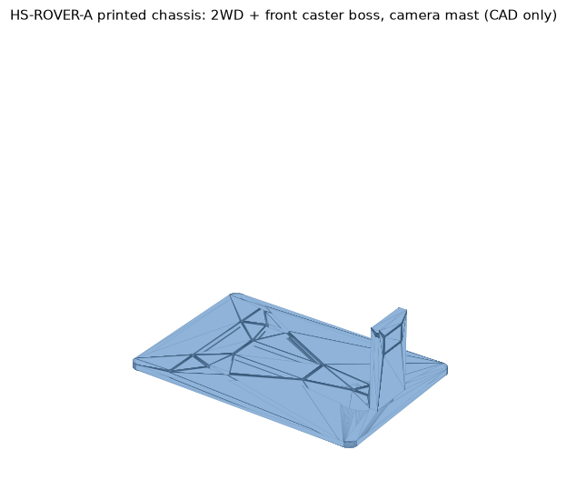

# HS-ROVER-A: an inspection rover, worked end to end through HS's agent interface



**Status: design package only. Nothing has been bought, printed, wired, powered or driven.**

This is the first objective carried from a plain brief to a build package entirely through Hardware-Splicer's MCP server,
the interface any outside agent uses. An agent (Claude Code, on 2026-11-26) made the engineering decisions; every
calculation, CAD build, check and file came from an HS tool over MCP, and HS kept the whole record on one project
(`project/ledger.jsonl`, 24 steps, each tool call with its inputs).

## Objective and acceptance (set before any design)

> Build an affordable, useful CCTV/inspection rover from obtainable parts: drives on indoor floors and gentle ramps,
> streams live video over Wi-Fi to a phone or laptop, and can be printed and assembled by one person.

| Acceptance | Result | Step |
|---|---|---|
| Parts at or under US$250, every price cited | US$242.32; **3 of 13 lines declared, not cited** (battery pack and charger, microSD, PLA and screws: US$36) | 20, open |
| 0.4 m/s on the flat, 15 degree ramp within maker limits | 0.79 m/s at full duty; 0.10 A cruise and 6.7% of stall torque on 15 degrees per motor | 17 |
| Prints on 220 mm, 15 mm ground clearance, no tip on 15 degrees | 180 x 120 x 64 mm part; 30.5 mm clearance; tips at 27 degrees (backward) at the earliest | 18 |
| Camera sees the floor ahead, chassis out of view | Nose out of view; floor visible from 113 mm ahead | 18 |
| At least 1 h patrol | 5.7 h at the average load (declared 2.8 W video, measured-model motor current); 0.6 A peak | 19 |
| Remaining risks listed for physical test | See below | status |

## How the design moved (all in the ledger)

1. **Prior art** (`hs_prior_art_search`, `hs_read_board`): the closest open board, roverbase, is GPL-3.0 with its own
   unfinished fixes; NASA-JPL's open rover is Apache but far larger; finished patrol robots are US$750-1,025.
   Decision: buy proven modules, print the chassis, no custom board.
2. **Drive** (`hs_size_rover_drive`): 29 of 38 cited gearmotors pass at 0.9 kg; chose Pololu 25D MP 12V 47:1 over the
   lowest-current 75:1 because 75:1 has no speed margin as the battery sags.
3. **Chassis** (`hs_rover_chassis`): first build failed (wheel 2.0 mm from the plate, 3 mm minimum); a 3.5 mm hub
   offset passed. The drive was re-checked at the chassis's own mass.
4. **Wheels**: Pololu's 90 mm wheel press-fits only 3 mm shafts; its holes take the 4 mm universal hub, so 90 mm
   replaced the assumed 80 mm and both checks re-ran.
5. **Budget** (`hs_bom_check`): four-wheel drive came to US$323.66 against US$250. Switched to rear two-wheel drive with
   a Pololu #2692 caster (29 mm tall, on a 1.5 mm printed boss), US$242.32. Chassis, drive and energy re-ran: still
   stable, with about 80% of the weight on the driven wheels.
6. **Software**: reuse MediaMTX (MIT) for WebRTC video from the Camera Module 3 and gpiozero's `PhaseEnableMotor` for
   the DRV8874 carriers in phase/enable mode; a 70-line drive page (`project/artifacts/software/`).
7. **Integration catch**: the Pi Zero 2 W needs the Zero camera cable, not the one supplied with Camera Module 3.

## Parts (`bom.json`)

Pololu: 2 x 25D MP 12V 47:1 gearmotor (#3229), bracket pair (#2676), 2 x DRV8874 carrier (#4035), 5 V 2.5 A regulator
D24V22F5 (#2858), 90 x 10 mm wheel pair (#1435), 4 mm universal hubs (#1081), ball caster (#2692). Adafruit: Raspberry Pi
Zero 2 W, Camera Module 3, Zero camera cable. Declared: 3S Li-ion pack 2.5 Ah with charger, microSD, PLA and screws.
Dimensions come from the makers' drawings: Pololu 25D datasheet rev 2.0, bracket bkt04c, caster cst05, Raspberry Pi
Zero 2 W and Camera Module 3 mechanical drawings (listed in `rover_chassis.py`).

## Needs a physical test

Traction, turning (skid and caster drag are not modelled), print strength, wheel/hub/bracket stack-up (hub offset is
declared), real battery runtime and the declared 2.5 W video load, the drive page and MediaMTX config on a real Pi, the
camera image, and the 3 A fuse choice. The three uncited prices need real quotes; the budget margin is US$7.68.

## Reproduce

Each step's tool and inputs are in `project/ledger.jsonl`; replay them through `hs_*` tools over MCP
(`python -m hardware_splicer.mcp_server`) or REST (`POST /v1/toolbelt/<tool>`). The chassis alone:

```bash
HARDWARE_SPLICER_DIGITAL_PYTHON=<python with cadquery> python -m hardware_splicer.engineering_toolbelt hs_project_open '{"objective": "rover"}'
```
