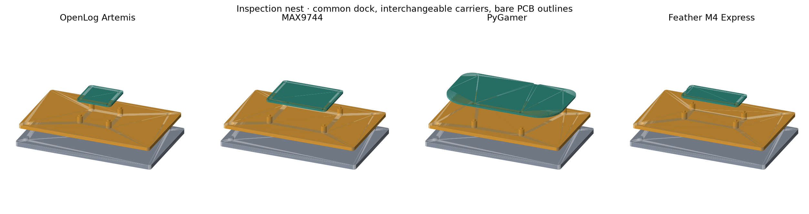

# HS PCB inspection nest v0.2

A desktop fixture for locating a loose circuit board horizontally during visual inspection. One dock accepts interchangeable carriers for four board revisions. Each carrier supports a bare board around its four mounting holes. Lift the board or the carrier straight up to change it. The 5 mm and 3.5 mm dock pins give the carrier a single orientation.



## What is in the release

For one station the design bill of materials is one dock and one carrier for the chosen board. Both are custom parts with integral pins. Each has an editable STEP solid and a millimetre-scale STL. The four assembly STEP files combine the same dock, the corresponding carrier and a reference outline of the bare board. The generator, input manifest, checks and source notices accompany the models. In the repository, open the models inside `inspection-nest-v0.2.zip`.

| Carrier | Compatible layout used for the model | Reference features |
|---|---|---|
| OpenLog | SparkFun OpenLog Artemis v1.0 | Four 3.302 mm holes on a 25.4 mm square |
| MAX9744 | Adafruit MAX9744 stereo amplifier at the pinned revision | Four 2.5 mm holes on a 48.26 × 35.56 mm rectangle |
| PyGamer | Adafruit PyGamer at the pinned revision | Four 3.0 mm holes. Top and bottom pairs have different spacing |
| Feather M4 Express | Adafruit Feather M4 Express at the pinned revision | Two 2.50 mm plated mount drills and two 2.54 mm plain drills on a 45.72 × 17.78 mm rectangle |

The dock is 120 × 76 mm. Each carrier is 116 × 72 mm and provides 6 mm of nominal space between its plate and the PCB underside. The pins are 0.4 mm smaller in diameter than their mating holes. The fit model uses the published nominal drill dimensions. These clearances and the modeled 1.6 mm board thickness are design assumptions. The gray dock, orange carrier and green board outline are separated vertically in the preview for visibility.

## Digital verification

The generator checks each source file against its pinned digest, reads the four declared mounting locations and verifies each reopened STEP. The release audit reconstructs the source board perimeter including arcs, checks each support shoulder meets the board around its hole, and verifies the upright carrier and board are collision-free at nominal dimensions. Rotating the carrier 180° produces interference with the dock pins. It also checks that each delivered STL is a closed positive-volume mesh and each assembly STEP reopens with three solids. See `models/verification.json` in the ZIP.

This is a gravity-seated digital design for stationary, horizontal inspection. The models omit components, cables and enclosures. A populated board needs underside keep-out and access checks. Fabrication tolerance, material and ESD suitability, stability under force and wear remain untested. The design provides no hold-down for transport, inversion or machining.

## Rebuild or adapt

The release was built with Python 3.13. The tested CAD and analysis library versions are in `requirements.txt`. Use the HS digital native Python environment or install these requirements in a separate environment. Run these commands in the directory containing this README.

```sh
python build.py /tmp/hs-nest-openlog --board openlog --cache /tmp/hs-nest-boards --fetch
python pack.py /tmp/hs-nest-release --cache /tmp/hs-nest-boards --fetch
```

A new compatible board needs one manifest entry with its pinned EAGLE layout, file digest, board center, outer dimensions and four reviewed mounting locations. Use `mount_refs` for named footprints and `plain_mount_xy_mm` for undesignated holes identified by their source coordinates. The current importer supports mounting features centered on the footprint origin and one closed exterior contour made of line or arc segments. Keep the dock interface fixed when adding a carrier. The dock plate, key locations and pin clearances are in `build.py`. Change those only for a new interface revision.

## Provenance

Hardware Splicer authored the dock, carriers, software and validation procedure. The original HS work is available under the included MIT license. Bare-board reference shapes were adapted from the external contour and mounting holes of the following layouts. Copper, artwork and components were omitted. Credit the original designers and preserve their respective share-alike terms for the board references, including those shown in the assemblies and preview. Original attribution notices are in `notices/`.

- SparkFun Electronics, OpenLog Artemis. [Pinned hardware](https://github.com/sparkfun/OpenLog_Artemis/tree/f9c8e66b7da6f27a4bf9be55016c5b9231b9fb22/Hardware) · [CC BY-SA 4.0](https://creativecommons.org/licenses/by-sa/4.0/)
- Adafruit Industries, MAX9744 Amplifier PCB. [Pinned layout](https://github.com/adafruit/Adafruit-MAX9744-Amplifier-PCB/tree/8df09f97bcc66b78a54ca049957f7637fdd513c0) · [CC BY-SA 3.0](https://creativecommons.org/licenses/by-sa/3.0/)
- Adafruit Industries, PyGamer PCB. The pinned README specifies Creative Commons Attribution-ShareAlike, without a version in that checkout. [Pinned attribution](https://github.com/adafruit/Adafruit-PyGamer-PCB/blob/6725ded4a2049f7bf44a9078c141ceb65a5547e9/README.md)
- Adafruit Industries, Feather M4 Express. Designed by Limor Fried/Ladyada. The derived bare-board reference uses the published outline and reviewed drill locations. [Pinned design and source notices](https://github.com/adafruit/Adafruit-Feather-M4-Express-PCB/tree/d98407a6071813bc35c39c6e88ca09c0c9ef6f18).
